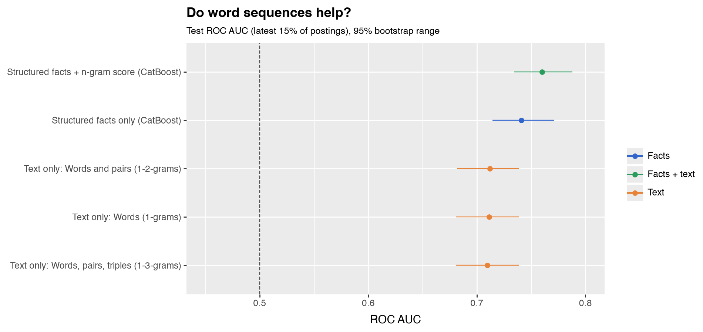
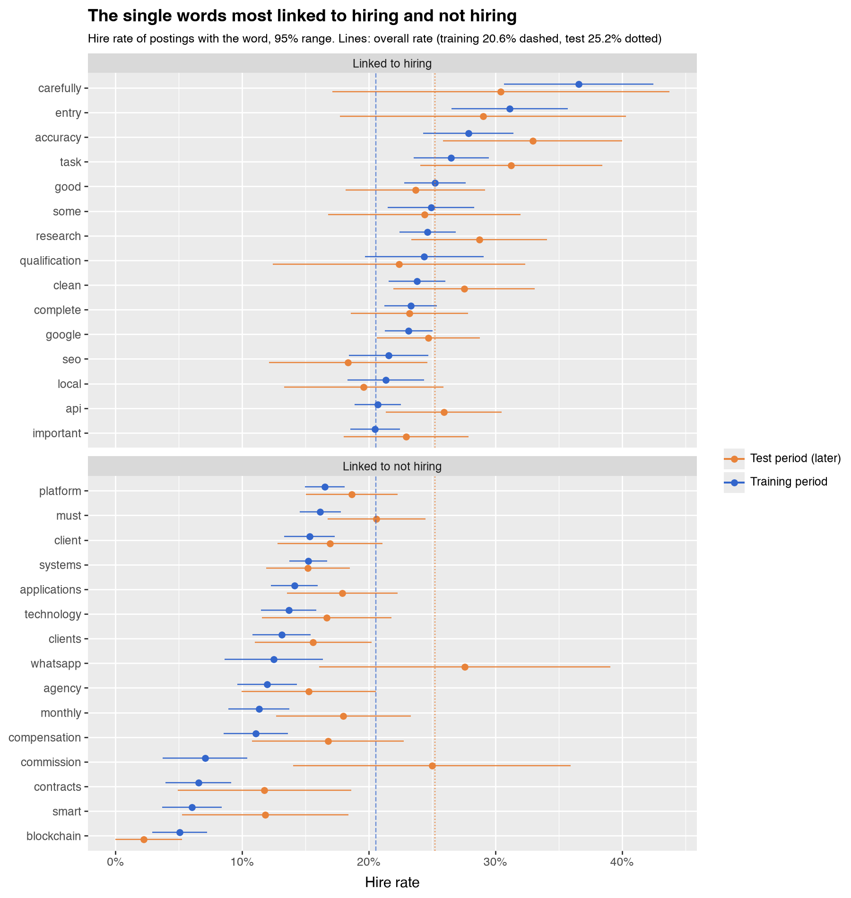
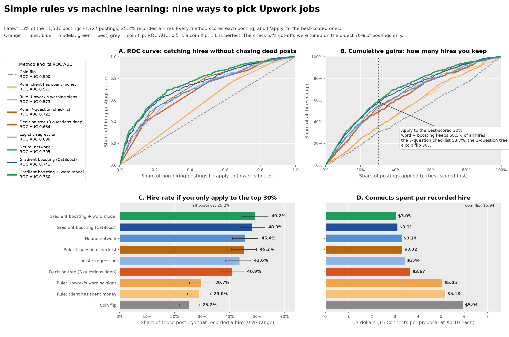
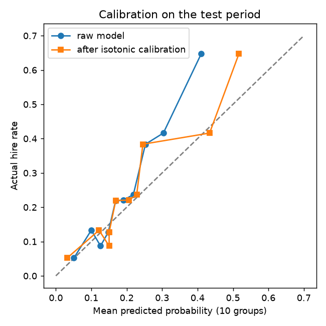
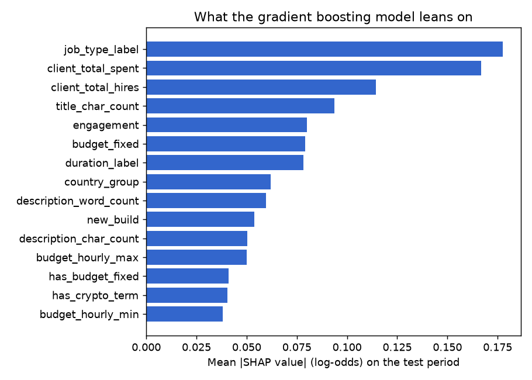

# Technical appendix: Which Upwork Jobs Actually Hire?

*Technical appendix for the study "Which Upwork jobs will hire? Simple rules vs machine learning". Figures are in `figures/`, the anonymised data and the one-script reproduction are in `public/`, and the full pipeline is in `scripts/` (it needs a private database, so it is there for transparency). Section references such as G4 or J1 point to sections of this file.*

**A. How the ranking was made.** I trained a model (gradient boosting, CatBoost) on the earliest 70% of postings, tuned it on the next 15% and tested it on the latest 15%, so it never sees the future. It uses only what is visible when a post appears; applicant and interview counts are excluded because they exist only afterwards. To rank a group of facts I scrambled that group on the test set and measured the fall in ROC AUC (0.5 is a coin flip, 1.0 is perfect), repeating 30 times. Scrambling a fact the model can replace with a related one understates its value; scrambling many related facts at once overstates it.

**B. Do word counts help?** I turned the text into single words (unigrams), pairs (bigrams) and triples (trigrams) and fed them to a simple model. On its own it scores 0.71, nearly as good as all the job and client facts (0.74). Added to the facts model, it lifts the score **from 0.741 to 0.760** (gain 0.019, 95% range 0.008 to 0.031). Pairs and triples add nothing beyond single words (0.711, 0.712, 0.709). The result holds when I test only on postings whose exact text never appeared in training.



These are the single words the word model leans on most. The chart compares each word's hire rate in the training period with the later test period.



| Words linked to **hiring** | Training postings | Hire rate | Test postings | Hire rate |
|---|---|---|---|---|
| research | 1,424 | 24.6% | 275 | 28.7% |
| task | 841 | 26.5% | 160 | 31.2% |
| complete | 1,613 | 23.3% | 319 | 23.2% |
| clean | 1,386 | 23.8% | 247 | 27.5% |
| entry | 392 | 31.1% | 62 | 29.0% |
| carefully | 257 | 36.6% | 46 | 30.4% |
| qualification | 324 | 24.4% | 67 | 22.4% |
| some | 614 | 24.9% | 123 | 24.4% |
| api | 1,893 | 20.7% | 351 | 25.9% |
| google | 1,952 | 23.2% | 429 | 24.7% |

| Words linked to **not hiring** | Training postings | Hire rate | Test postings | Hire rate |
|---|---|---|---|---|
| blockchain | 394 | 5.1% | 90 | 2.2% |
| smart | 397 | 6.0% | 93 | 11.8% |
| whatsapp | 280 | 12.5% | 58 | 27.6% |
| must | 1,986 | 16.2% | 422 | 20.6% |
| systems | 2,227 | 15.2% | 454 | 15.2% |
| contracts | 351 | 6.6% | 85 | 11.8% |
| monthly | 662 | 11.3% | 200 | 18.0% |
| client | 1,260 | 15.3% | 313 | 16.9% |
| agency | 734 | 12.0% | 177 | 15.3% |
| clients | 831 | 13.1% | 237 | 15.6% |

Some words hold up on the test period (*blockchain*, *contracts*, *agency*, *systems* stay low; *research*, *task*, *clean*, *entry*, *carefully* stay high). Others do not: *whatsapp* hired 12.5% in training but 27.6% in the test period. A word ranks high because of its weight in the model after the other words are counted, so it need not stand out on its own (*some* and *google* are near average). The signal comes from many small hints, not a few magic words.

**C. A scan of 3,671 words and phrases.** I scanned every word and two-word phrase appearing in at least 100 postings and kept only those that survive adjustment. Crypto and web3 terms hire rarely (blockchain 4.6%, smart contract 3.1%). So do startup and advisory words (investor 7.5%, consultancy 7.8%). Words like "laptop" (56.4%) and "internet connection" (45%) hire often; my guess is these go with data entry and similar tasks, but I have not read them one by one. I treat this as a source of leads, not findings.

**D. The AI-marker dictionary.** It covers symbols and typography, formatting pasted from chat windows, leftovers (tracking strings, chatbot talk, placeholders), sentence patterns and stock words, each with a weight and an evidence grade. Sources: Wikipedia's guide to signs of AI writing, and studies of words LLMs overuse. The em dash is only a medium-strength sign, since humans and autocorrect use it too.

**E. Upwork's advice versus my data.** Upwork says short, vague posts are the red flag and detailed ones suggest a good client. In my data, long posts hire less. These do not conflict, since Upwork is talking about scams and I measure recorded hires, but "looks professional" is not a reliable cue.

## F. The models in detail

Everything below is what `11_rules_vs_models.py`, `12_ngrams.py` and `15_method_comparison.py` do. All scores are on the latest 15% of postings (1,727 postings, 25.2% recorded a hire).

### F1. The setup every method shares

Postings are sorted by the time they were first captured. The oldest 70% (8,054 postings) train a model, the next 15% tune it (for example to decide when to stop), and the latest 15% are used once to score it. A model therefore never learns from postings that appeared after the ones it is judged on.

```python
n = len(df); i_tr, i_va = int(n * 0.70), int(n * 0.85)
tr, va, te = slice(0, i_tr), slice(i_tr, i_va), slice(i_va, n)
```

The models see 52 facts about each posting, all known when it appears: job type, budget, duration, engagement, tier, tags, the client's spend and past hires, country, length of title and description, style counts, copies seen earlier, the content flags (crypto, agency wording, new build and so on) and the time of posting. Applicant counts, interview counts and proposal tiers are left out because they exist only afterwards.

### F2. How the methods are scored

```text
ROC AUC        = P(score of a random hired posting > score of a random non-hired posting)
                 + 0.5 * P(the two scores are equal)           0.5 = coin flip, 1.0 = perfect
Top-30% rule   apply to the k = 0.30 * n best-scored postings
hire rate      = (hires among the k) / k
hires kept     = (hires among the k) / (all hires in the test period)
cost per hire  = (k * Connects * price) / (hires among the k)   Connects = 15, price = $0.10
95% range      bootstrap: resample the test postings, recompute, take the 2.5th and 97.5th percentiles
```

Ties matter for the rules, which have only a few distinct scores. I break ties at random, once, with the same random order for every method.

```python
order = np.lexsort((random_tiebreak, -score))     # best score first, random order among ties
top = order[: int(round(len(y) * 0.30))]
hire_rate = y[top].mean(); hires_kept = y[top].sum() / y.sum()
usd_per_hire = len(top) * 15 * 0.10 / y[top].sum()
```

### F3. The rules (no training)

The first rule is "client has spent money": score 1 if the client's total spend is above zero, else 0. The second is Upwork's own warning signs: the score is minus the number of signs present, taken from the four my data can test (a new client with no spend, a request to leave the platform for Telegram or WhatsApp, crypto wording, and text copied from an earlier posting). The third is the seven-question checklist from the article: fixed price, client has spent money, 10 or more past hires, project 3 months or shorter, no crypto or web3 wording, no agency wording, and 400 words or fewer. Its three cut-offs were tuned on the oldest 70% of postings only (section G4), and it scores ROC AUC 0.722 and 45.2% in the top 30% on the test period.

### F4. Decision tree (a learned rule)

A tree asks yes/no questions. At each step it picks the question that makes the two resulting groups as pure as possible, measured by Gini impurity.

```text
Gini of a group with hire share p:   G = 1 - p^2 - (1-p)^2 = 2 * p * (1 - p)
Chosen split minimises:              (n_left * G_left + n_right * G_right) / n
```

I limited it to 3 questions deep, with at least 100 postings in every group, and gave it 11 yes/no facts: fixed price, has spend, 10+ past hires, crypto, copied, agency wording, new build, over 400 words, asks to leave the platform, "fix" in the title and long-term wording.

```python
tree = DecisionTreeClassifier(max_depth=3, min_samples_leaf=100, random_state=42).fit(T.iloc[tr], y[tr])
```

The eight rules it learned (also in `data/decision_tree_rules.txt`):

| The post has... | Hire rate in training | Hire rate in the test period |
|---|---|---|
| a client with spend history, fixed price, 400 words or fewer | 32.8% (2,000 postings) | **48.4%** (364) |
| a client with spend history, fixed price, over 400 words | 23.0% (627) | 24.4% (131) |
| a client with spend history, hourly, 400 words or fewer | 21.2% (2,156) | 25.8% (511) |
| a client with spend history, hourly, over 400 words | 15.3% (1,259) | 13.4% (322) |
| no spend history, no crypto, 400 words or fewer | 14.4% (1,061) | 21.5% (181) |
| no spend history, no crypto, over 400 words | 8.6% (525) | 8.7% (115) |
| no spend history, crypto, asks to build something new | 3.6% (111) | 5.3% (19) |
| no spend history, crypto, not a new build | 1.6% (315) | 3.6% (84) |

### F5. Logistic regression

A weighted sum of the facts, squashed into a probability.

```text
z = b0 + b1*x1 + b2*x2 + ... + bk*xk
p(hire) = 1 / (1 + exp(-z))
fit by minimising   C * sum_i [ -y_i*log(p_i) - (1-y_i)*log(1-p_i) ]  +  0.5 * sum_j b_j^2        (C = 0.5)
```

Numbers are filled with the median and standardised. Categories become one-hot columns, and categories with fewer than 30 postings are grouped together.

```python
prep = ColumnTransformer([
    ("num", make_pipeline(SimpleImputer(strategy="median"), StandardScaler()), numeric_cols),
    ("cat", OneHotEncoder(handle_unknown="ignore", min_frequency=30), categorical_cols)])
logit = make_pipeline(prep, LogisticRegression(C=0.5, max_iter=3000)).fit(X.iloc[tr], y[tr])
```

### F6. Gradient boosting (CatBoost)

Many small trees added one after another. Each new tree is fitted to what the previous ones still get wrong.

```text
F_0(x)   = a constant starting score (for instance the log-odds of the hire share)
for m = 1 ... M:
    g_i  = y_i - sigmoid( F_{m-1}(x_i) )        what is still wrong for posting i
    fit a depth-6 tree h_m to g_i
    F_m(x) = F_{m-1}(x) + 0.04 * h_m(x)         0.04 = learning rate
stop when the AUC on the validation postings has not improved for 100 rounds (at most 1,500 rounds)
p(hire)  = sigmoid( F_M(x) )          (simplified: CatBoost's real update also uses second-order information)
```

CatBoost builds symmetric trees (the same question on every branch of a level) and handles categories directly, without one-hot columns, by turning each category into a number computed only from earlier rows (ordered target statistics).

```python
model = CatBoostClassifier(iterations=1500, learning_rate=0.04, depth=6, eval_metric="AUC",
                           early_stopping_rounds=100, random_seed=42, verbose=0)
model.fit(Pool(X.iloc[tr], y[tr], cat_features=cat_idx),
          eval_set=Pool(X.iloc[va], y[va], cat_features=cat_idx))
```

### F7. Neural network

Two hidden layers of 64 and 32 units with ReLU, trained with Adam on the same log loss as logistic regression plus an L2 penalty.

```text
h1 = relu(W1 . x + b1)      64 units
h2 = relu(W2 . h1 + b2)     32 units
p(hire) = sigmoid(w3 . h2 + b3)
```

A single run of a small network is noisy, so I average five runs that differ only in their random start.

```python
def fit_and_predict(seed):
    mlp = make_pipeline(prep, MLPClassifier(hidden_layer_sizes=(64, 32), alpha=1e-2, early_stopping=True,
                        validation_fraction=0.15, n_iter_no_change=15, max_iter=400, random_state=seed))
    return mlp.fit(X.iloc[tr], y[tr]).predict_proba(X.iloc[te])[:, 1]
score = np.mean([fit_and_predict(s) for s in range(5)], axis=0)
```

### F8. The word model and stacking

Each posting (title and description, lower-case, links and emails removed) becomes a vector of word weights.

```text
tf-idf(t, d) = (1 + ln count(t, d)) * ( ln((1 + N) / (1 + df(t))) + 1 )     then each vector is scaled to length 1
```

Here `count` is how often word t appears in posting d, `N` is the number of training postings and `df(t)` is how many of them contain t. Words found in fewer than 5 postings or in more than half of all postings are dropped. A logistic regression on these weights predicts a hire. Its strength `C` is picked from 0.1, 0.3, 1, 3 and 10 by the validation AUC (0.3 for single words, 1 for pairs and triples).

```python
vec = TfidfVectorizer(ngram_range=(1, 1), min_df=5, max_df=0.5, sublinear_tf=True)
words = LogisticRegression(C=0.3, max_iter=2000).fit(vec.fit_transform(text[tr]), y[tr])
```

To feed it to the gradient boosting model I use stacking: the word model's score becomes a 53rd fact. For the training postings the score comes from 5-fold out-of-fold predictions (each fold is predicted by a model fitted on the other four), so the boosting model never sees a score computed from a posting's own answer. Validation and test postings are scored by the model fitted on all the training postings.

### F9. The comparison



Panel A shows the ROC curve of each method, panel B the share of hires kept as you apply to more postings (best-scored first), panel C the hire rate in the top 30% with its 95% range, and panel D the Connects cost per recorded hire.

| Method | ROC AUC | 95% range |
|---|---|---|
| Client has spent money | 0.573 | 0.549 to 0.591 |
| Upwork's four warning signs | 0.573 | 0.548 to 0.595 |
| Decision tree, 3 questions | 0.684 | 0.656 to 0.713 |
| Logistic regression | 0.698 | 0.668 to 0.729 |
| Neural network | 0.705 | 0.676 to 0.733 |
| Seven-question checklist | 0.722 | 0.699 to 0.751 |
| Gradient boosting | 0.741 | 0.714 to 0.771 |
| Gradient boosting + word model | 0.760 | 0.734 to 0.788 |

How much to read into the order? The ranges of neighbouring methods overlap, so I compared them with a paired bootstrap (section G3). Gradient boosting is clearly better than the decision tree, logistic regression and the neural network, and slightly better than the checklist (+0.019, 95% range 0.001 to 0.037). The neural network and logistic regression cannot be told apart. The word model improves the overall ranking (+0.019, 0.008 to 0.031), but its gain in the top-30% hire rate (+1.1 points, -1.2 to 3.5) is not clear. The test period has only 1,727 postings, and all ranges reflect only the resampling of those postings, not retraining the models.

## G. Checks added after an editorial review

These are the analyses behind the claims in the article that need more than a table: how a hire is recorded, what "adjusted" means, whether differences between methods are real, and how much the checklist depends on choices I made. Scripts: `16_publication_checks.py` (G2 to G5) and the tables in `data/`.

### G1. How a hire is recorded

Each posting is captured once (97.7% from job-alert emails, the rest from the Upwork app's feed). The table `job_activity_checks` then holds repeated checks of the posting's public activity panel. Each check stores the job status and the counts shown there: total applicants, total hired, invited to interview, unanswered invites and invitations sent. The labelled data has 32,349 checks for 11,506 postings (about 2.8 per posting). For the alert-email postings the checks run on average 8.8 days after capture and up to 50 days after.

```text
hired      = 1 if total_hired > 0 at ANY check, else 0 when checking stops
resolved   = the time of the check that first showed a hire, or the end of checking
median time from capture to resolution = 22 days (21.3 days on average for non-hires, 20.2 for hires)
```

Because a hire is only noticed at the next check, the data cannot say when the hire happened. "Not hired" includes postings still open, closed without a hire, filled off the platform, and hired after the last check. The job status field is "open" for every posting and carries no information.

### G2. The adjusted odds ratios

One logistic regression on all 11,507 postings, fitted with `statsmodels.Logit`. The outcome is `hired`. Predictors are the yes/no signals in the article (crypto wording, wallet terms, request to leave the platform, copied text, em dash, no spend history, fixed price, Philippines, agency wording, new build, long-term wording, screening prompt, quick-task wording, "fix" in the title, crypto and Philippines together), the AI-style signal count and the AI-marker score, region dummies (reference group: the US, UK, Australia, Canada and New Zealand), and three standardised numbers (log10 of description words, log10 of the client's spend, log of past hires).

```text
log( p / (1 - p) ) = b0 + b1*x1 + ... + bk*xk
odds ratio for x_j = exp(b_j)                  1 = no effect, 0.5 = the odds of a hire are halved
95% range          = exp(b_j +/- 1.96 * standard_error_j)
```

For a yes/no signal the odds ratio compares postings with and without it, holding the other predictors fixed. For a standardised number it is the change for one standard deviation. Pseudo R-squared is 0.07, so the signals explain only part of the variation. Selected results (all in `data/inference_logistic_odds_ratios.csv`):

| Term | Odds ratio | 95% range |
|---|---|---|
| Fixed-price job | 1.62 | 1.46 to 1.79 |
| Client past hires (per standard deviation) | 1.46 | 1.34 to 1.59 |
| Title about fixing | 1.20 | 0.91 to 1.60 |
| Em dash present | 1.01 | 0.86 to 1.18 |
| AI-marker score (per point) | 0.98 | 0.94 to 1.03 |
| Description length (per standard deviation) | 0.90 | 0.85 to 0.96 |
| Asks to build something new | 0.80 | 0.72 to 0.89 |
| Asks to leave the platform | 0.78 | 0.62 to 0.99 |
| Crypto or web3 wording | 0.68 | 0.54 to 0.85 |
| Agency wording | 0.69 | 0.52 to 0.92 |
| Client has no spend history | 0.54 | 0.43 to 0.68 |
| Client in the Philippines (with crypto in the model) | 0.54 | 0.18 to 1.65 |
| Text copied by others (2+ times) | 0.52 | 0.42 to 0.65 |

Many hypotheses were tested in the repository (`03_inference.py` also reports two-proportion tests with Benjamini-Hochberg correction), so a result near the edge, such as "asks to leave the platform" (p = 0.041), should be read as suggestive.

### G3. Paired bootstrap for the comparison of methods

Two methods are scored on the same 1,727 test postings, so their errors are linked. To test a difference, resample the postings with replacement 2,000 times, recompute both scores on each resample, and look at the spread of the difference.

```python
diffs = []
for i in resamples:                       # 2,000 index arrays drawn with replacement
    diffs.append(roc_auc_score(y[i], score_a[i]) - roc_auc_score(y[i], score_b[i]))
lo, hi = np.percentile(diffs, [2.5, 97.5])   # a range that excludes 0 means A and B really differ
```

The same is done for the hire rate in the top 30% (with the same random tie-break). Results (`data/paired_tests.csv`):

| Method A minus method B | AUC difference (95% range) | Top-30% hire rate difference, points |
|---|---|---|
| Gradient boosting minus decision tree | +0.057 (0.034 to 0.080) | +7.2 (4.1 to 10.6) |
| Gradient boosting minus checklist | +0.019 (0.001 to 0.037) | +3.4 (0.6 to 6.2) |
| Gradient boosting minus logistic regression | +0.043 (0.022 to 0.063) | +5.2 (2.1 to 8.1) |
| Gradient boosting minus neural network | +0.037 (0.016 to 0.056) | +2.9 (0.0 to 5.8) |
| Neural network minus logistic regression | +0.006 (-0.006 to 0.018) | +2.3 (0.0 to 4.6) |
| Boosting plus words minus boosting alone | +0.019 (0.008 to 0.031) | +1.1 (-1.2 to 3.5) |
| Boosting plus words minus decision tree | +0.075 (0.052 to 0.098) | +8.3 (5.0 to 11.6) |
| Decision tree minus "has spent money" | +0.111 (0.092 to 0.131) | +12.3 (8.1 to 16.6) |
| Checklist minus "has spent money" | +0.149 (0.126 to 0.174) | +16.1 (11.8 to 20.3) |
| Upwork's four signs minus "has spent money" | -0.001 (-0.017 to 0.016) | +0.8 (-1.2 to 2.9) |

The bootstrap resamples the test postings only. It does not capture the variation from retraining the models, from a different time period, or from the choices made while building the checklist.

### G4. How the checklist was built and checked

The seven questions are fixed in advance: fixed price, client has spent money, a minimum number of past hires, a maximum project length, no crypto or web3 wording, no agency wording, and a maximum description length. The three cut-offs are tuned on the oldest 70% of postings only, by taking the cut-off whose yes/no answer has the highest ROC AUC against `hired` in that period.

```python
candidates = {"past hires >=": [1, 2, 3, 5, 10, 20, 50, 100],
              "project length up to (code)": [1, 2, 3],            # 1 = under 1 month, 2 = 1 to 3 months, 3 = 3 to 6 months
              "words <=": [100, 150, 200, 250, 300, 400, 500, 600, 800]}
# each cut-off: argmax over candidates of roc_auc_score(y_train, answer_train)
# chosen: 10 past hires, 3 months or shorter, 400 words or fewer   (the same as the ones I had picked by eye)
```

Test result: ROC AUC 0.722 (0.699 to 0.751). Hire rate by points is in the article. What this does not remove is the choice of the seven *questions*, which came from exploring all the data. To measure that, a second version chooses the questions automatically: from a pool of 22 yes/no facts, forward selection adds, one at a time, the question that most improves the training AUC of the point total.

```text
pool (22 facts): fixed price; spent money; spent $1,000+; spent $10,000+; 1+, 10+, 50+ past hires; project up to 3 months;
  project under 1 month; no crypto; no agency wording; no "build something new"; text not copied before; no request to leave the platform;
  no em dash; no long-term wording; no screening prompt; description 400 or fewer words; 200 or fewer words; title 60 or fewer characters;
  client in an English-speaking country; not a premium listing
selected (training only): 10+ past hires, fixed price, spent money, project up to 3 months, description 400 or fewer words, 50+ past hires, title 60 or fewer characters
test ROC AUC 0.704 (0.675 to 0.731); training ROC AUC 0.661
```

The automatic version picked five of my seven questions. Crypto and agency wording were not picked because they are rare, so they add little to the AUC even though each is a strong warning when present. (A first attempt that simply took the seven individually strongest facts scored 0.669, because they overlap: three versions of "past hires" and two of "spent money".) So a fair range for a seven-question checklist is about 0.70 to 0.72.

### G5. Budget, competition and the applicant counts

```text
market money per posting = hire rate (all postings in the budget group) * median budget
per applicant            = market money per posting / median number of applicants in the group
```

The per-applicant figure assumes every applicant has the same chance, which flatters big jobs where skills and credentials matter more. The final applicant count is known for 74% of fixed-price postings (the count at the last check), and in that subset the hire rate is higher than overall, so I use the hire rate from all postings and only borrow the median number of applicants. Median applicants by budget group: 13, 16, 21, 21 and 33. The gap between the smallest and largest budget group is about 45 times per posting and about 18 times per applicant.

### G6. Description length: how much does it help?

Script `17_length_feature.py`, outputs `data/length_*.csv`. Test period only, 95% ranges from 2,000 bootstrap resamples.

| Comparison | ROC AUC | 95% range |
|---|---|---|
| Length alone, hump-shaped lookup learned on the oldest 70% | 0.605 | 0.573 to 0.635 |
| "Client has spent money" alone | 0.573 | 0.549 to 0.591 |
| Gradient boosting, all 52 facts | 0.745 | |
| Gradient boosting without the two length facts | 0.745 | |
| Difference (with minus without) | 0.000 | -0.007 to 0.006 |
| Checklist, seven questions | 0.722 | 0.699 to 0.751 |
| Checklist without the 400-word question | 0.701 | 0.676 to 0.730 |
| Difference (seven minus six) | +0.021 | 0.011 to 0.030 |

Boosting numbers are averages over three seeds (42, 43, 44). The hire rate by length band within job type, spend history and period is in `data/length_robustness.csv`.

## H. The facts and how the models were trained

### H1. The 52 facts the models see

Every model got the same 52 facts per posting, in 20 groups. They are listed in order of importance. "Score drop" is how far the ROC AUC falls on the test period when I shuffle that group's values (a bigger drop means the model leans on it more), with a 95% range.

| # | Group | What's in it | Facts | Score drop |
|---|---|---|---|---|
| 1 | Duration, engagement, tier | Project length, hours per week, experience level asked for | 3 | 0.035 (0.025 to 0.044) |
| 2 | Budget | Fixed budget, hourly minimum and maximum, whether a fixed budget is set | 4 | 0.033 (0.023 to 0.043) |
| 3 | Job type | Fixed price or hourly | 1 | 0.032 (0.023 to 0.041) |
| 4 | Client spend history | Total the client has spent on Upwork | 1 | 0.015 (0.005 to 0.025) |
| 5 | Description length | Characters and words | 2 | 0.015 (0.008 to 0.022) |
| 6 | Client past hires | How many people the client has hired | 1 | 0.009 (0.003 to 0.015) |
| 7 | Writing style | Average sentence length and how much it varies, lines, exclamation marks, bullets | 5 | 0.006 (0.001 to 0.011) |
| 8 | Title length | Characters in the title | 1 | 0.005 (-0.000 to 0.009) |
| 9 | Client country | Country and country group | 2 | 0.003 (-0.003 to 0.009) |
| 10 | Text copied by others | How many earlier postings have the same description or title | 2 | 0.003 (-0.001 to 0.006) |
| 11 | Other request wording | "Fix" in the title, long-term, quick-task and screening-question wording | 4 | 0.002 (0.000 to 0.003) |
| 12 | Crypto and wallet words | Crypto or web3 terms, wallet terms | 2 | 0.002 (-0.003 to 0.006) |
| 13 | Agency wording | Phrases like "our client" and "white-label" | 1 | 0.001 (-0.000 to 0.001) |
| 14 | Asks to build something new | Wording about creating something from scratch | 1 | 0.001 (-0.002 to 0.003) |
| 15 | Client badge and payment check | Top-client badge, payment verified | 2 | 0.000 (0.000 to 0.000) |
| 16 | Other job settings | Location required, enterprise, premium, number of tags, number of skills | 5 | 0.000 (0.000 to 0.000) |
| 17 | Links and emails | A link or an email address in the text | 2 | -0.000 (-0.001 to 0.001) |
| 18 | Posting time | Hour, weekday, age of the posting when captured | 3 | -0.000 (-0.005 to 0.004) |
| 19 | AI-style marks | Em dashes, curly quotes, markdown, emoji, stock phrases, non-ASCII share, dictionary score | 9 | -0.001 (-0.005 to 0.004) |
| 20 | Asks to leave the platform | Telegram, WhatsApp or similar | 1 | -0.001 (-0.003 to 0.000) |

Only the first seven groups show a drop clearly above zero. Groups that overlap (for example, budget and job type) share credit, so each drop understates how much that information is worth on its own. I left out on purpose anything that is only known after people respond: the number of proposals and interviews, the proposals tier, whether I applied, and where I saw the posting. Those would leak the answer.

### H2. How the facts were made

Most of the 52 facts are read straight from the posting: budget, project length, client spend, client past hires, number of tags and skills. The rest I computed from the title and description:

- **Word-list flags** are case-insensitive pattern searches. Crypto: crypto, bitcoin, blockchain, web3, NFT, DeFi, Solana, Binance, MetaMask, airdrop. Wallet: seed phrase, private key, wallet, recovery phrase. Off-platform: Telegram, WhatsApp, Skype, Discord, WeChat. Agency: "our client", "on behalf of", "white-label", "our agency", reseller, subcontract. New build: "from scratch", "build a", "create a", "new website/app/platform", MVP, prototype, startup. Fix: fix, bug, debug, broken, "not working", troubleshoot, repair, crash ("fixed price" is excluded on purpose). I wrote the content-type lists before looking at hire outcomes. They are crude: a post about "blockchain analytics" counts as crypto.
- **Copies** count how many earlier-captured postings have the same description (lower-cased, whitespace squashed), and the same for the title. Only earlier copies count, because a later copy would be information from the future.
- **Length and style** are characters and words, the mean and spread of sentence length, line count, exclamation marks and bullet points.
- **AI-style marks** are counts of em dashes, curly quotes, markdown, emoji and stock phrases, plus a dictionary score (the 33-mark dictionary is documented in `references/05_llm_markers_dictionary.md`).

### H3. Training choices

- **Missing values.** Gradient boosting reads empty numbers as they are. For the logistic regression and the neural network I filled them with the median and standardised. Empty categories become "unknown" and are one-hot encoded (categories under 30 postings are pooled). The spend rules treat an empty client spend as zero, which is about a quarter of postings.
- **A time split, not random folds.** Reposts are common, so a random split would put copies of the same post on both sides and let the model learn from the future. I train on the oldest 70%, tune on the next 15% and test on the latest 15%.
- **No hyperparameter search.** I set the settings by hand and never tuned anything on the test period: CatBoost (at most 1,500 trees, learning rate 0.04, depth 6, stop when the tuning slice stops improving), logistic regression (C = 0.5), tree (depth 3, at least 100 postings per leaf), network (two layers of 64 and 32 units, average of five runs). A proper search could move any of them a little, and a tuned network might close part of its gap to boosting.
- **Class balance.** 21.9% of postings hired. I didn't reweight or resample, because I judge the ranking (AUC, top 30%), not a fixed cut-off.
- **Leakage.** Anything known only after people respond (proposal and interview counts, the proposals tier, whether I applied) is out, and copy counts look only backwards.

## I. More ways to judge the best model

ROC AUC and the top 30% test aren't the only lenses. The numbers in this part come from the public script `public/reproduce.py` on the shared CSV (money columns rounded, so gradient boosting scores 0.744 there against 0.741 above).

**Precision and recall.** Apply to the top 30% by gradient boosting and 48.3% of those postings hire (precision), against a base rate of 25.2%. You keep 57.3% of all hires while applying to 30% of postings (recall). PR AUC is 0.50 against 0.25 for a coin flip.

**Run-to-run noise.** Five seeds of the same boosting model give a mean AUC of 0.744, standard deviation 0.004, range 0.739 to 0.749. So I wouldn't trust a gap of less than about 0.01 between two models from a single run.

**Calibration.** The probabilities are too low at the top. The top tenth of postings was given an average of 41% and 65% actually hired, partly because the hire rate rose over time. Calibrating on the tuning slice (isotonic regression) improves the Brier score only a little (0.1686 to 0.1652, against 0.1909 for always predicting the base rate). Use the scores to rank, not to quote percentages.



**What the model leans on.** SHAP values (the push each fact gives to a single posting's score, computed by CatBoost itself) agree with the group ranking: job type, client spend and client past hires are on top. Title length ranks fourth here although its permutation drop was small, because the two measures ask different questions, and I wouldn't read much into it.



**Where it fails.** About a quarter (24.5%) of the test hires sit in the bottom half of the model's ranking. They are mostly hourly jobs (78%, against 24% among the hires the model catches), from clients with far fewer past hires (median 5 against 42) and longer descriptions (median 358 words against 174), though 69% of those clients have spent money. The misses are mostly hourly work from smaller clients.

## J. Sixty-four more models against the checklist

Script `public/benchmark_models.py`, results in `public/results/benchmark_*.csv`. All models trained on the oldest 70% of postings. They were ranked on the next 15% (tuning slice, never used for training or early stopping, which for boosting uses the last 15% of the training slice). The latest 15% (test) was only used to score what had been picked. The checklist scores 0.683 on the tuning slice and 0.722 on the test slice.

Candidates (64 in all): logistic regression (L2 at five strengths, L1 at two, elastic net), ridge classifier, linear SVM, SGD, linear discriminant analysis, Gaussian naive Bayes; k nearest neighbours (k = 25, 75, 200); RBF-kernel SVM (two settings); decision trees (depth 3, 5, 8), random forests, extra trees; AdaBoost, scikit-learn gradient boosting, HistGradientBoosting; CatBoost (depth, learning rate, regularisation and class-weight variants), LightGBM, XGBoost; seven scikit-learn neural networks (one to five layers, averaged over three seeds each; PyTorch isn't available for the Python version I used, so no transformers or TabNet); four models built on the checklist answers or 12 key facts; and eight combinations (rank-averaged blends and logistic stacking, members chosen on the tuning slice).

On the tuning slice 56 of the 64 beat the checklist; on the test slice 37 do, and nine clearly (range of the difference above zero). Weakest: RBF SVMs (0.65), naive Bayes (0.52), nearest neighbours (0.69).

### J1. The top 10, chosen on the tuning slice

| Rank | Method | Family | Tuning slice AUC | Test AUC | Difference from checklist (95% range) |
|---|---|---|---|---|---|
| 1 | Blend: best boosting + best neural net + best linear | Combination | 0.745 | 0.739 | +0.016 (-0.002 to 0.034) |
| 2 | Blend: best 10 on the tuning slice | Combination | 0.743 | 0.734 | +0.011 (-0.009 to 0.030) |
| 3 | Blend: best 3 on the tuning slice | Combination | 0.742 | 0.732 | +0.009 (-0.012 to 0.030) |
| 4 | MLP (256, 128), alpha=0.01 | Neural net | 0.742 | 0.729 | +0.006 (-0.016 to 0.029) |
| 5 | Blend: best 5 on the tuning slice | Combination | 0.741 | 0.731 | +0.009 (-0.012 to 0.030) |
| 6 | MLP (64, 32), alpha=0.001 | Neural net | 0.738 | 0.730 | +0.007 (-0.014 to 0.028) |
| 7 | Blend: CatBoost depth 6 + logistic regression C=0.1 | Combination | 0.738 | 0.736 | +0.014 (-0.004 to 0.032) |
| 8 | MLP (64, 32), alpha=0.1 | Neural net | 0.738 | 0.728 | +0.006 (-0.015 to 0.027) |
| 9 | MLP (256, 128, 64, 32, 16), alpha=0.01 | Neural net | 0.737 | 0.730 | +0.008 (-0.013 to 0.028) |
| 10 | MLP (64, 32), alpha=0.01 | Neural net | 0.737 | 0.727 | +0.004 (-0.018 to 0.024) |

### J2. The nine models that clearly beat the checklist on the test slice

These were found after looking at the test slice, so treat the gaps as optimistic.

| Rank | Method | Family | Tuning slice AUC | Test AUC | Difference from checklist (95% range) |
|---|---|---|---|---|---|
| 45 | CatBoost on 12 key facts only | Checklist+ | 0.723 | 0.747 | +0.025 (0.009 to 0.040) |
| 49 | CatBoost + checklist points as an extra fact | Checklist+ | 0.721 | 0.745 | +0.022 (0.009 to 0.036) |
| 39 | CatBoost, strong regularisation (l2=20) | Boosting | 0.727 | 0.743 | +0.020 (0.003 to 0.036) |
| 43 | CatBoost, depth 4 | Boosting | 0.724 | 0.742 | +0.020 (0.001 to 0.037) |
| 42 | XGBoost, depth 3 | Boosting | 0.725 | 0.742 | +0.019 (0.001 to 0.037) |
| 14 | Blend: all boosting models | Combination | 0.734 | 0.741 | +0.019 (0.002 to 0.035) |
| 33 | Random forest, leaf>=20 | Trees | 0.729 | 0.740 | +0.017 (0.000 to 0.034) |
| 41 | CatBoost, depth 8 | Boosting | 0.726 | 0.739 | +0.017 (0.000 to 0.033) |
| 18 | Random forest, balanced classes | Trees | 0.733 | 0.739 | +0.016 (0.001 to 0.033) |
