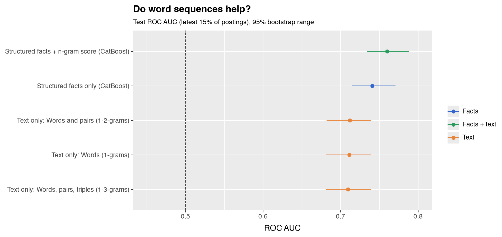
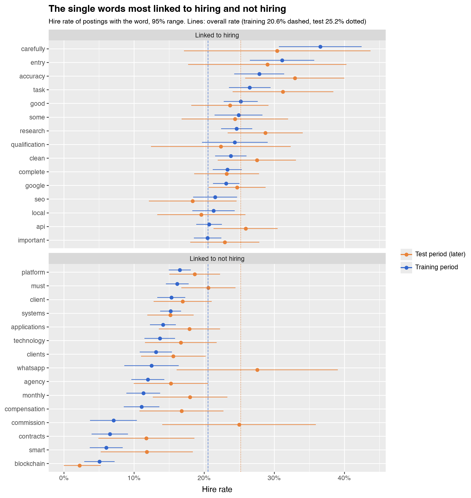
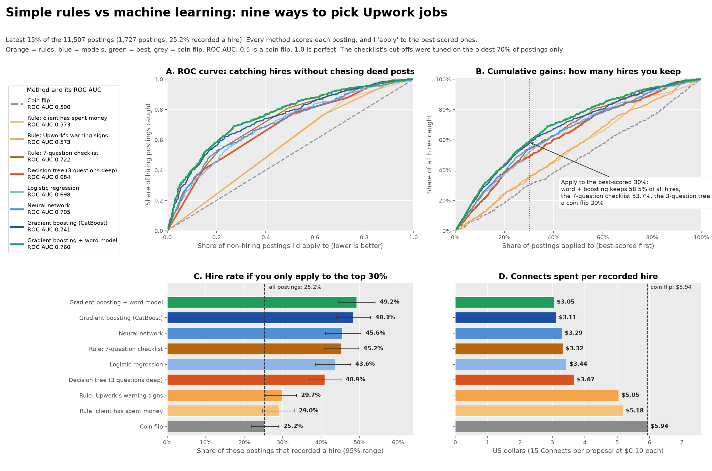
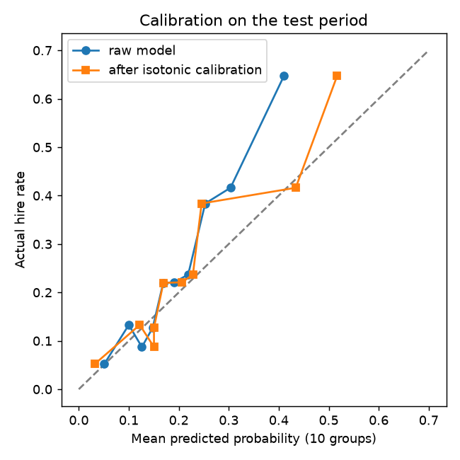
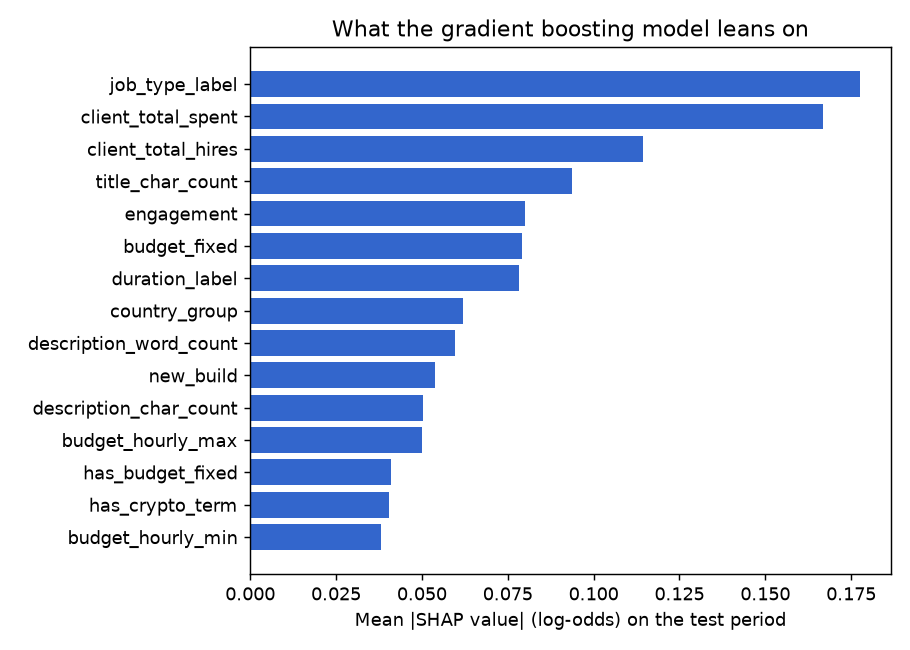

# Техническое приложение: какие вакансии на Upwork действительно нанимают?

*Техническое приложение к исследованию «Какие вакансии на Upwork закрываются наймом: простые правила против машинного обучения». Графики лежат в `figures/`, обезличенные данные и воспроизведение одним скриптом в `public/`, полный конвейер в `scripts/` (ему нужна закрытая база данных, поэтому он здесь для прозрачности).*

**А. Как построено ранжирование.** Я обучил модель (градиентный бустинг, CatBoost) на самых ранних 70% вакансий, настроил на следующих 15% и проверил на самых поздних 15%, чтобы она не видела будущего. Она использует только то, что видно в момент появления вакансии; число откликов и интервью исключено, потому что оно известно только позже. Чтобы оценить группу фактов, я перемешивал эту группу на тесте и измерял падение ROC AUC (0,5 это монетка, 1,0 идеал), повторяя 30 раз. Перемешивание факта, который модель может заменить близким, занижает его ценность; перемешивание сразу многих близких фактов завышает её.

**Б. Помогают ли подсчёты слов?** Я превратил текст в отдельные слова (юниграммы), пары (биграммы) и тройки (триграммы) и подал их в простую модель. Сама по себе она даёт 0,71, почти как все факты о работе и клиенте (0,74). Добавленная к модели на фактах, она поднимает оценку **с 0,741 до 0,760** (прирост 0,019, 95% диапазон от 0,008 до 0,031). Пары и тройки ничего не добавляют к отдельным словам (0,711, 0,712, 0,709). Результат сохраняется, если проверять только вакансии, точный текст которых не встречался при обучении.



Вот отдельные слова, на которые словесная модель опирается сильнее всего. График сравнивает долю найма для каждого слова в обучающем периоде с более поздним тестовым.



| Слова, связанные с **наймом** | Вакансий в обучении | Доля найма | Вакансий в тесте | Доля найма |
|---|---|---|---|---|
| research | 1 424 | 24,6% | 275 | 28,7% |
| task | 841 | 26,5% | 160 | 31,2% |
| complete | 1 613 | 23,3% | 319 | 23,2% |
| clean | 1 386 | 23,8% | 247 | 27,5% |
| entry | 392 | 31,1% | 62 | 29,0% |
| carefully | 257 | 36,6% | 46 | 30,4% |
| qualification | 324 | 24,4% | 67 | 22,4% |
| some | 614 | 24,9% | 123 | 24,4% |
| api | 1 893 | 20,7% | 351 | 25,9% |
| google | 1 952 | 23,2% | 429 | 24,7% |

| Слова, связанные с **отсутствием найма** | Вакансий в обучении | Доля найма | Вакансий в тесте | Доля найма |
|---|---|---|---|---|
| blockchain | 394 | 5,1% | 90 | 2,2% |
| smart | 397 | 6,0% | 93 | 11,8% |
| whatsapp | 280 | 12,5% | 58 | 27,6% |
| must | 1 986 | 16,2% | 422 | 20,6% |
| systems | 2 227 | 15,2% | 454 | 15,2% |
| contracts | 351 | 6,6% | 85 | 11,8% |
| monthly | 662 | 11,3% | 200 | 18,0% |
| client | 1 260 | 15,3% | 313 | 16,9% |
| agency | 734 | 12,0% | 177 | 15,3% |
| clients | 831 | 13,1% | 237 | 15,6% |

Часть слов подтверждается на тесте (*blockchain*, *contracts*, *agency*, *systems* остаются низкими; *research*, *task*, *clean*, *entry*, *carefully* остаются высокими). Другие нет: *whatsapp* нанимало в 12,5% случаев в обучении, но в 27,6% в тесте. Слово занимает высокое место из-за своего веса в модели после учёта других слов, поэтому само по себе оно может не выделяться (*some* и *google* около среднего). Сигнал складывается из множества небольших подсказок, а не из нескольких «волшебных слов».

**В. Сканирование 3 671 слова и фразы.** Я просканировал все слова и фразы из двух слов, встречающиеся минимум в 100 вакансиях, и оставил только те, что переживают поправку. Крипто и web3 нанимают редко (blockchain 4,6%, smart contract 3,1%). То же со словами про стартапы и консалтинг (investor 7,5%, consultancy 7,8%). Слова вроде «laptop» (56,4%) и «internet connection» (45%) нанимают часто; я предполагаю, что это вакансии про ввод данных и похожее, но по одной их не читал. Я считаю это источником гипотез, а не выводами.

**Г. Словарь AI-примет.** Он охватывает символы и типографику, оформление, вставленное из окон чата, следы (строки отслеживания, реплики чат-бота, незаполненные шаблоны), конструкции предложений и штампованные слова, у каждой приметы есть вес и степень надёжности. Источники: руководство Википедии по признакам текста ИИ и исследования слов, которые LLM используют слишком часто. Длинное тире это признак лишь средней силы, потому что его используют и люди, и автозамена.

**Д. Советы Upwork и мои данные.** Upwork пишет, что короткие расплывчатые вакансии это тревожный знак, а подробные говорят о хорошем клиенте. В моих данных длинные вакансии нанимают реже. Это не противоречие, потому что Upwork говорит о мошенничестве, а я измеряю записанный найм, но «выглядит профессионально» это ненадёжный сигнал.

## Ж. Модели подробно

Всё ниже это то, что делают `11_rules_vs_models.py`, `12_ngrams.py` и `15_method_comparison.py`. Все оценки посчитаны на самых поздних 15% вакансий (1 727 вакансий, найм записан у 25,2%).

### Ж1. Общая схема для всех методов

Вакансии отсортированы по времени, когда они были впервые записаны. Самые ранние 70% (8 054 вакансии) обучают модель, следующие 15% настраивают её (например, чтобы решить, когда остановиться), а самые поздние 15% используются один раз для оценки. Поэтому модель никогда не учится на вакансиях, появившихся позже тех, по которым её оценивают.

```python
n = len(df); i_tr, i_va = int(n * 0.70), int(n * 0.85)
tr, va, te = slice(0, i_tr), slice(i_tr, i_va), slice(i_va, n)
```

Модели видят 52 факта о каждой вакансии, известных в момент её появления: тип работы, бюджет, срок, занятость, уровень, теги, траты и прошлые наймы клиента, страна, длина названия и описания, счётчики стиля, копии, виденные раньше, признаки содержания (крипто, формулировки агентства, «создать новое» и так далее) и время публикации. Число откликов, число интервью и уровни откликов не используются, потому что они известны только позже.

### Ж2. Как оцениваются методы

```text
ROC AUC        = P(оценка случайной вакансии с наймом > оценка случайной вакансии без найма)
                 + 0.5 * P(оценки равны)                       0.5 = монетка, 1.0 = идеал
Правило top-30%  откликаться на k = 0.30 * n вакансий с лучшей оценкой
доля найма     = (наймы среди k) / k
сохранено      = (наймы среди k) / (все наймы в тестовом периоде)
цена найма     = (k * Connects * цена) / (наймы среди k)       Connects = 15, цена = $0.10
95% диапазон   bootstrap: перевыборка тестовых вакансий, пересчёт, 2.5-й и 97.5-й процентили
```

Для правил важны ничьи, потому что у них лишь несколько разных значений оценки. Я разрешаю ничьи случайно, один раз, с одним и тем же случайным порядком для всех методов.

```python
order = np.lexsort((random_tiebreak, -score))     # сначала лучшая оценка, среди равных случайный порядок
top = order[: int(round(len(y) * 0.30))]
hire_rate = y[top].mean(); hires_kept = y[top].sum() / y.sum()
usd_per_hire = len(top) * 15 * 0.10 / y[top].sum()
```

### Ж3. Правила (без обучения)

Первое правило: «клиент тратил деньги», оценка 1, если общие траты клиента больше нуля, иначе 0. Второе: собственные тревожные признаки Upwork, оценка равна минус числу найденных признаков из четырёх, которые мои данные позволяют проверить (новый клиент без трат, просьба перейти в Telegram или WhatsApp, крипто в тексте и текст, скопированный из более ранней вакансии). Третье: мой чек-лист из 7 пунктов: фиксированная цена, клиент тратил деньги, 10 и больше прошлых наймов, проект короче 3 месяцев, нет крипто, нет формулировок агентства и не больше 400 слов. Пороги я выбрал после просмотра всех данных, так что его результат (ROC AUC 0,674, 38,8% в верхних 30%) оптимистичен.

### Ж4. Дерево решений (выученное правило)

Дерево задаёт вопросы «да/нет». На каждом шаге оно выбирает вопрос, после которого две получившиеся группы максимально «чистые» по примеси Джини.

```text
Джини группы с долей найма p:    G = 1 - p^2 - (1-p)^2 = 2 * p * (1 - p)
Выбирается разбиение, минимизирующее:   (n_left * G_left + n_right * G_right) / n
```

Я ограничил глубину тремя вопросами, не меньше 100 вакансий в каждой группе, и дал ему 11 фактов «да/нет»: фиксированная цена, есть траты, 10+ прошлых наймов, крипто, копия, формулировки агентства, «создать новое», больше 400 слов, просьба уйти с платформы, «fix» в названии и долгосрочные формулировки.

```python
tree = DecisionTreeClassifier(max_depth=3, min_samples_leaf=100, random_state=42).fit(T.iloc[tr], y[tr])
```

Восемь правил, которые оно выучило (они же в `data/decision_tree_rules.txt`):

| В вакансии | Доля найма в обучении | Доля найма в тестовом периоде |
|---|---|---|
| клиент с историей трат, фиксированная цена, до 400 слов | 32,8% (2 000 вакансий) | **48,4%** (364) |
| клиент с историей трат, фиксированная цена, больше 400 слов | 23,0% (627) | 24,4% (131) |
| клиент с историей трат, почасовая оплата, до 400 слов | 21,2% (2 156) | 25,8% (511) |
| клиент с историей трат, почасовая оплата, больше 400 слов | 15,3% (1 259) | 13,4% (322) |
| нет истории трат, нет крипто, до 400 слов | 14,4% (1 061) | 21,5% (181) |
| нет истории трат, нет крипто, больше 400 слов | 8,6% (525) | 8,7% (115) |
| нет истории трат, крипто, просят создать что-то новое | 3,6% (111) | 5,3% (19) |
| нет истории трат, крипто, не «создать новое» | 1,6% (315) | 3,6% (84) |

### Ж5. Логистическая регрессия

Взвешенная сумма фактов, сжатая в вероятность.

```text
z = b0 + b1*x1 + b2*x2 + ... + bk*xk
p(найм) = 1 / (1 + exp(-z))
обучение минимизирует   C * sum_i [ -y_i*log(p_i) - (1-y_i)*log(1-p_i) ]  +  0.5 * sum_j b_j^2        (C = 0.5)
```

Пропуски в числах заполняются медианой, числа стандартизируются. Категории превращаются в one-hot столбцы, а категории реже чем в 30 вакансиях объединяются.

```python
prep = ColumnTransformer([
    ("num", make_pipeline(SimpleImputer(strategy="median"), StandardScaler()), numeric_cols),
    ("cat", OneHotEncoder(handle_unknown="ignore", min_frequency=30), categorical_cols)])
logit = make_pipeline(prep, LogisticRegression(C=0.5, max_iter=3000)).fit(X.iloc[tr], y[tr])
```

### Ж6. Градиентный бустинг (CatBoost)

Много маленьких деревьев, добавляемых одно за другим. Каждое новое дерево обучается на том, в чём прежние всё ещё ошибаются.

```text
F_0(x)   = постоянная начальная оценка (например, логарифм шансов доли найма)
для m = 1 ... M:
    g_i  = y_i - sigmoid( F_{m-1}(x_i) )        в чём ещё ошибка для вакансии i
    обучить дерево глубины 6 h_m на g_i
    F_m(x) = F_{m-1}(x) + 0.04 * h_m(x)         0.04 = скорость обучения
остановиться, когда AUC на валидационных вакансиях не растёт 100 раундов (не больше 1 500)
p(найм)  = sigmoid( F_M(x) )          (упрощённо: реальное обновление CatBoost использует и вторые производные)
```

CatBoost строит симметричные деревья (один и тот же вопрос во всех ветках уровня) и работает с категориями напрямую, без one-hot столбцов, превращая каждую категорию в число, посчитанное только по более ранним строкам (упорядоченные целевые статистики).

```python
model = CatBoostClassifier(iterations=1500, learning_rate=0.04, depth=6, eval_metric="AUC",
                           early_stopping_rounds=100, random_seed=42, verbose=0)
model.fit(Pool(X.iloc[tr], y[tr], cat_features=cat_idx),
          eval_set=Pool(X.iloc[va], y[va], cat_features=cat_idx))
```

### Ж7. Нейронная сеть

Два скрытых слоя по 64 и 32 нейрона с ReLU, обучение Adam на той же логарифмической потере, что и у логистической регрессии, плюс штраф L2.

```text
h1 = relu(W1 . x + b1)      64 нейрона
h2 = relu(W2 . h1 + b2)     32 нейрона
p(найм) = sigmoid(w3 . h2 + b3)
```

Один запуск маленькой сети шумный, поэтому я усредняю пять запусков, отличающихся только случайным стартом.

```python
def fit_and_predict(seed):
    mlp = make_pipeline(prep, MLPClassifier(hidden_layer_sizes=(64, 32), alpha=1e-2, early_stopping=True,
                        validation_fraction=0.15, n_iter_no_change=15, max_iter=400, random_state=seed))
    return mlp.fit(X.iloc[tr], y[tr]).predict_proba(X.iloc[te])[:, 1]
score = np.mean([fit_and_predict(s) for s in range(5)], axis=0)
```

### Ж8. Словесная модель и стекинг

Каждая вакансия (название и описание, в нижнем регистре, без ссылок и адресов почты) превращается в вектор весов слов.

```text
tf-idf(t, d) = (1 + ln count(t, d)) * ( ln((1 + N) / (1 + df(t))) + 1 )     затем каждый вектор приводится к длине 1
```

Здесь `count` это сколько раз слово t встречается в вакансии d, `N` число обучающих вакансий, а `df(t)` в скольких из них есть слово t. Слова, встречающиеся меньше чем в 5 вакансиях или больше чем в половине всех, отбрасываются. Логистическая регрессия на этих весах предсказывает найм. Её сила `C` выбирается из 0,1, 0,3, 1, 3 и 10 по AUC на валидации (0,3 для отдельных слов, 1 для пар и троек).

```python
vec = TfidfVectorizer(ngram_range=(1, 1), min_df=5, max_df=0.5, sublinear_tf=True)
words = LogisticRegression(C=0.3, max_iter=2000).fit(vec.fit_transform(text[tr]), y[tr])
```

Чтобы передать её градиентному бустингу, я использую стекинг: оценка словесной модели становится 53-м фактом. Для обучающих вакансий оценка берётся из предсказаний «вне выборки» по 5 блокам (каждый блок предсказывается моделью, обученной на остальных четырёх), чтобы бустинг никогда не видел оценку, посчитанную по ответу самой вакансии. Валидационные и тестовые вакансии оцениваются моделью, обученной на всех обучающих вакансиях.

### Ж9. Сравнение



Панель A показывает ROC-кривую каждого метода, панель B долю сохранённых наймов по мере отклика на всё больше вакансий (сначала лучшие по оценке), панель C долю найма в верхних 30% с 95% диапазоном, а панель D стоимость Connects на один записанный найм.

| Метод | ROC AUC | 95% диапазон |
|---|---|---|
| Клиент тратил деньги | 0,573 | от 0,549 до 0,591 |
| Четыре тревожных признака Upwork | 0,573 | от 0,548 до 0,595 |
| Дерево решений, 3 вопроса | 0,684 | от 0,656 до 0,713 |
| Логистическая регрессия | 0,698 | от 0,668 до 0,729 |
| Нейронная сеть | 0,705 | от 0,676 до 0,733 |
| Градиентный бустинг | 0,741 | от 0,714 до 0,771 |
| Градиентный бустинг + словесная модель | 0,760 | от 0,734 до 0,788 |

Сколько смысла видеть в порядке? Диапазоны соседних методов пересекаются, например у логистической регрессии и нейронной сети, так что их порядок я бы не считал решённым. Большие разрывы яснее: правила из одного вопроса заметно ниже всех остальных, а градиентный бустинг со словесной моделью выше дерева решений. В тестовом периоде всего 1 727 вакансий, а диапазоны отражают только перевыборку этих вакансий, а не переобучение моделей. Прирост от словесной модели (+0,019, 95% диапазон от 0,008 до 0,031) измерен так же.

## З. Признаки и обучение моделей

### З1. 52 признака, которые видят модели

Каждая модель получала одни и те же 52 факта о вакансии, разбитые на 20 групп. Они перечислены по важности. «Падение оценки» показывает, насколько падает ROC AUC на тестовом периоде, если перемешать значения этой группы (чем больше падение, тем сильнее модель на неё опирается), с 95% диапазоном.

| № | Группа | Что входит | Признаков | Падение оценки |
|---|---|---|---|---|
| 1 | Срок, занятость, уровень | Длительность проекта, часов в неделю, запрошенный уровень опыта | 3 | 0,035 (от 0,025 до 0,044) |
| 2 | Бюджет | Фиксированный бюджет, минимум и максимум почасовой ставки, указан ли фиксированный бюджет | 4 | 0,033 (от 0,023 до 0,043) |
| 3 | Вид работы | Фиксированная цена или почасовая оплата | 1 | 0,032 (от 0,023 до 0,041) |
| 4 | История трат клиента | Сколько клиент потратил на Upwork всего | 1 | 0,015 (от 0,005 до 0,025) |
| 5 | Длина описания | Символы и слова | 2 | 0,015 (от 0,008 до 0,022) |
| 6 | Прошлые наймы клиента | Сколько людей нанял клиент | 1 | 0,009 (от 0,003 до 0,015) |
| 7 | Стиль письма | Средняя длина предложения и её разброс, строки, восклицательные знаки, списки | 5 | 0,006 (от 0,001 до 0,011) |
| 8 | Длина заголовка | Символов в заголовке | 1 | 0,005 (от -0,000 до 0,009) |
| 9 | Страна клиента | Страна и группа стран | 2 | 0,003 (от -0,003 до 0,009) |
| 10 | Текст скопирован другими | Сколько более ранних вакансий имеют такое же описание или заголовок | 2 | 0,003 (от -0,001 до 0,006) |
| 11 | Прочие формулировки запроса | «Fix» в заголовке, формулировки про долгий срок, быструю задачу и вопросы для отбора | 4 | 0,002 (от 0,000 до 0,003) |
| 12 | Крипто и кошельки | Крипто- и web3-термины, слова про кошельки | 2 | 0,002 (от -0,003 до 0,006) |
| 13 | Формулировки агентств | Фразы вроде «our client» и «white-label» | 1 | 0,001 (от -0,000 до 0,001) |
| 14 | Просьба создать новое | Формулировки про создание с нуля | 1 | 0,001 (от -0,002 до 0,003) |
| 15 | Значок клиента и проверка оплаты | Значок топ-клиента, подтверждена ли оплата | 2 | 0,000 (от 0,000 до 0,000) |
| 16 | Прочие настройки вакансии | Обязательная локация, enterprise, premium, число тегов, число навыков | 5 | 0,000 (от 0,000 до 0,000) |
| 17 | Ссылки и почта | Ссылка или адрес почты в тексте | 2 | -0,000 (от -0,001 до 0,001) |
| 18 | Время публикации | Час, день недели, возраст вакансии при записи | 3 | -0,000 (от -0,005 до 0,004) |
| 19 | Приметы ИИ-стиля | Длинные тире, косые кавычки, markdown, эмодзи, штампы, доля не-ASCII символов, оценка по словарю | 9 | -0,001 (от -0,005 до 0,004) |
| 20 | Просьба уйти с платформы | Telegram, WhatsApp и подобное | 1 | -0,001 (от -0,003 до 0,000) |

Заметно выше нуля падение только у первых семи групп. Группы, которые пересекаются (например, бюджет и вид работы), делят заслугу между собой, поэтому каждое падение занижает ценность этой информации самой по себе. Я намеренно не включал всё, что становится известно только после реакции людей: число откликов и интервью, уровень откликов, подавал ли я отклик и где я увидел вакансию. Это выдало бы ответ.

### З2. Как были построены признаки

Большинство из 52 признаков читается прямо из вакансии: бюджет, срок проекта, траты клиента, прошлые наймы клиента, число тегов и навыков. Остальные я вычислял из заголовка и описания:

- **Флаги по спискам слов** это поиск по шаблонам без учёта регистра. Крипто: crypto, bitcoin, blockchain, web3, NFT, DeFi, Solana, Binance, MetaMask, airdrop. Кошелёк: seed phrase, private key, wallet, recovery phrase. Уход с платформы: Telegram, WhatsApp, Skype, Discord, WeChat. Агентство: «our client», «on behalf of», «white-label», «our agency», reseller, subcontract. Новая разработка: «from scratch», «build a», «create a», «new website/app/platform», MVP, prototype, startup. Починка: fix, bug, debug, broken, «not working», troubleshoot, repair, crash («fixed price» исключено намеренно). Списки про тип работы я составил до того, как посмотрел на исходы найма. Они грубые: вакансия про «blockchain analytics» считается крипто.
- **Копии** считают, сколько ранее записанных вакансий имеют такое же описание (в нижнем регистре, пробелы сжаты), и то же для заголовка. Учитываются только более ранние копии, потому что поздняя копия была бы информацией из будущего.
- **Длина и стиль** это символы и слова, среднее и разброс длины предложений, число строк, восклицательных знаков и пунктов списка.
- **Приметы ИИ-стиля** это число длинных тире, косых кавычек, markdown, эмодзи и штампов, плюс оценка по словарю (словарь из 33 примет описан в `references/05_llm_markers_dictionary_RU.md`).

### З3. Выбор при обучении

- **Пропуски.** Градиентный бустинг читает пустые числа как есть. Для логистической регрессии и нейросети я заполнял их медианой и стандартизировал. Пустые категории становятся «unknown» и кодируются one-hot (категории меньше чем из 30 вакансий объединяются). Правила про траты считают пустое значение трат нулём, это около четверти вакансий.
- **Разбиение по времени, а не случайные фолды.** Перепубликации часты, поэтому случайное разбиение положило бы копии одной вакансии по обе стороны, и модель училась бы на будущем. Я обучаю на самых ранних 70%, настраиваю на следующих 15% и проверяю на самых поздних 15%.
- **Без подбора гиперпараметров.** Настройки я задал вручную и ничего не подбирал на тестовом периоде: CatBoost (не больше 1 500 деревьев, шаг обучения 0,04, глубина 6, остановка, когда настроечная часть перестаёт улучшаться), логистическая регрессия (C = 0,5), дерево (глубина 3, не меньше 100 вакансий в листе), нейросеть (два слоя по 64 и 32 нейрона, среднее из пяти запусков). Нормальный подбор мог бы немного изменить любую из моделей, а настроенная нейросеть могла бы сократить часть отставания от бустинга.
- **Баланс классов.** Нанимают 21,9% вакансий. Я не взвешивал и не пересэмплировал, потому что оцениваю ранжирование (AUC, верхние 30%), а не фиксированный порог.
- **Утечки.** Всё, что известно только после реакции людей (число откликов и интервью, уровень откликов, подавал ли я отклик), исключено, а счётчики копий смотрят только назад.

## И. Ещё способы оценить лучшую модель

ROC AUC и тест «верхние 30%» это не единственные способы. Числа в этой части получены публичным скриптом `public/reproduce.py` на выложенном CSV (денежные столбцы округлены, поэтому бустинг там даёт 0,744 вместо 0,741 выше).

**Точность и полнота.** Если откликаться на верхние 30% по градиентному бустингу, нанимают 48,3% этих вакансий (точность) при базовой доле 25,2%. Вы сохраняете 57,3% всех наймов, откликаясь на 30% вакансий (полнота). PR AUC равен 0,50 против 0,25 у монетки.

**Разброс между запусками.** Пять сидов одной и той же модели бустинга дают средний AUC 0,744, стандартное отклонение 0,004, диапазон от 0,739 до 0,749. Поэтому разрыву меньше примерно 0,01 между двумя моделями по одному запуску я бы не доверял.

**Калибровка.** Вероятности занижены в верхней части. Верхней десятой части вакансий модель дала в среднем 41%, а нанимали 65%, отчасти потому что доля найма со временем выросла. Калибровка на настроечной части (изотоническая регрессия) улучшает оценку Брайера лишь немного (от 0,1686 до 0,1652, при 0,1909 у постоянного прогноза базовой доли). Используйте оценки для ранжирования, а не для цитирования процентов.



**На что опирается модель.** Значения SHAP (вклад каждого факта в оценку одной вакансии, их считает сам CatBoost) согласуются с рейтингом групп: сверху вид работы, траты клиента и прошлые наймы клиента. Длина заголовка здесь на четвёртом месте, хотя её падение при перемешивании было мало: эти две меры отвечают на разные вопросы, и я бы не придавал этому большого значения.



**Где модель ошибается.** Около четверти (24,5%) наймов на тесте лежат в нижней половине ранжирования модели. Это в основном почасовые работы (78% против 24% среди наймов, которые модель ловит), от клиентов со значительно меньшим числом прошлых наймов (медиана 5 против 42) и с более длинными описаниями (медиана 358 слов против 174), хотя 69% этих клиентов тратили деньги. Промахи в основном приходятся на почасовую работу от небольших клиентов.

## К. Ещё шестьдесят четыре модели против чек-листа

Скрипт `public/benchmark_models.py`, результаты в `public/results/benchmark_*.csv`. Все модели обучались на самых ранних 70% вакансий. Ранжировали их по следующим 15% (настроечная часть, которая не использовалась ни для обучения, ни для ранней остановки: у бустинга она идёт по последним 15% обучающей части). Самые поздние 15% (тест) использовались только для оценки уже выбранных моделей. Чек-лист даёт 0,683 на настроечной части и 0,722 на тестовой.

Кандидаты (всего 64): логистическая регрессия (L2 с пятью силами, L1 с двумя, эластичная сеть), ridge-классификатор, линейный SVM, SGD, линейный дискриминантный анализ, гауссов наивный Байес; k ближайших соседей (k = 25, 75, 200); SVM с RBF-ядром (две настройки); решающие деревья (глубина 3, 5, 8), случайные леса, extra trees; AdaBoost, градиентный бустинг scikit-learn, HistGradientBoosting; CatBoost (варианты глубины, шага обучения, регуляризации и весов классов), LightGBM, XGBoost; семь нейросетей scikit-learn (от одного до пяти слоёв, среднее по трём сидам; PyTorch недоступен для моей версии Python, поэтому трансформеров и TabNet нет); четыре модели на ответах чек-листа или 12 ключевых фактах; и восемь комбинаций (усреднение рангов и логистический стекинг, участники выбирались по настроечной части).

На настроечной части чек-лист обходят 56 из 64 моделей, на тестовой 37, а уверенно девять (диапазон разницы выше нуля). Слабее всех: SVM с RBF-ядром (0,65), наивный Байес (0,52), ближайшие соседи (0,69).

### К1. Десятка лучших, выбранная по настроечной части

| Место | Метод | Семейство | AUC на настроечной части | AUC на тесте | Разница с чек-листом (95% диапазон) |
|---|---|---|---|---|---|
| 1 | Blend: best boosting + best neural net + best linear | Combination | 0,745 | 0,739 | +0,016 (от -0,002 до 0,034) |
| 2 | Blend: best 10 on the tuning slice | Combination | 0,743 | 0,734 | +0,011 (от -0,009 до 0,030) |
| 3 | Blend: best 3 on the tuning slice | Combination | 0,742 | 0,732 | +0,009 (от -0,012 до 0,030) |
| 4 | MLP (256, 128), alpha=0.01 | Neural net | 0,742 | 0,729 | +0,006 (от -0,016 до 0,029) |
| 5 | Blend: best 5 on the tuning slice | Combination | 0,741 | 0,731 | +0,009 (от -0,012 до 0,030) |
| 6 | MLP (64, 32), alpha=0.001 | Neural net | 0,738 | 0,730 | +0,007 (от -0,014 до 0,028) |
| 7 | Blend: CatBoost depth 6 + logistic regression C=0.1 | Combination | 0,738 | 0,736 | +0,014 (от -0,004 до 0,032) |
| 8 | MLP (64, 32), alpha=0.1 | Neural net | 0,738 | 0,728 | +0,006 (от -0,015 до 0,027) |
| 9 | MLP (256, 128, 64, 32, 16), alpha=0.01 | Neural net | 0,737 | 0,730 | +0,008 (от -0,013 до 0,028) |
| 10 | MLP (64, 32), alpha=0.01 | Neural net | 0,737 | 0,727 | +0,004 (от -0,018 до 0,024) |

### К2. Девять моделей, которые уверенно лучше чек-листа на тесте

Их нашли после просмотра тестовой части, поэтому разницы завышены.

| Место | Метод | Семейство | AUC на настроечной части | AUC на тесте | Разница с чек-листом (95% диапазон) |
|---|---|---|---|---|---|
| 45 | CatBoost on 12 key facts only | Checklist+ | 0,723 | 0,747 | +0,025 (от 0,009 до 0,040) |
| 49 | CatBoost + checklist points as an extra fact | Checklist+ | 0,721 | 0,745 | +0,022 (от 0,009 до 0,036) |
| 39 | CatBoost, strong regularisation (l2=20) | Boosting | 0,727 | 0,743 | +0,020 (от 0,003 до 0,036) |
| 43 | CatBoost, depth 4 | Boosting | 0,724 | 0,742 | +0,020 (от 0,001 до 0,037) |
| 42 | XGBoost, depth 3 | Boosting | 0,725 | 0,742 | +0,019 (от 0,001 до 0,037) |
| 14 | Blend: all boosting models | Combination | 0,734 | 0,741 | +0,019 (от 0,002 до 0,035) |
| 33 | Random forest, leaf>=20 | Trees | 0,729 | 0,740 | +0,017 (от 0,000 до 0,034) |
| 41 | CatBoost, depth 8 | Boosting | 0,726 | 0,739 | +0,017 (от 0,000 до 0,033) |
| 18 | Random forest, balanced classes | Trees | 0,733 | 0,739 | +0,016 (от 0,001 до 0,033) |
